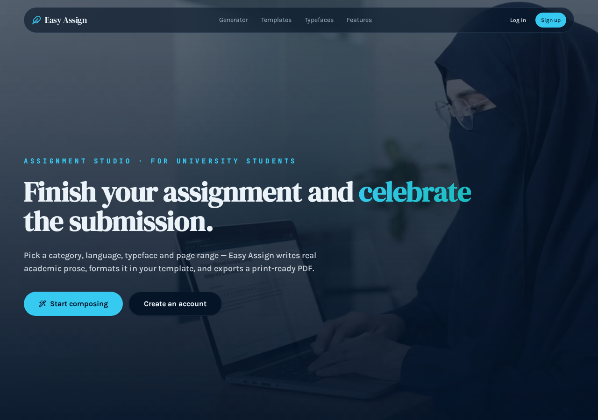
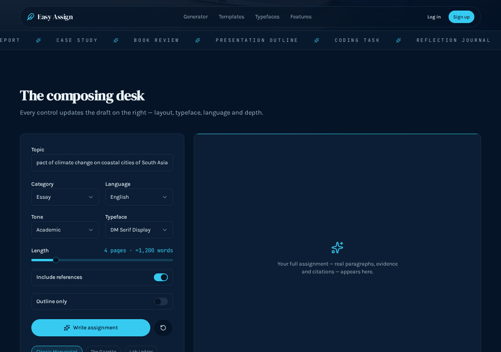
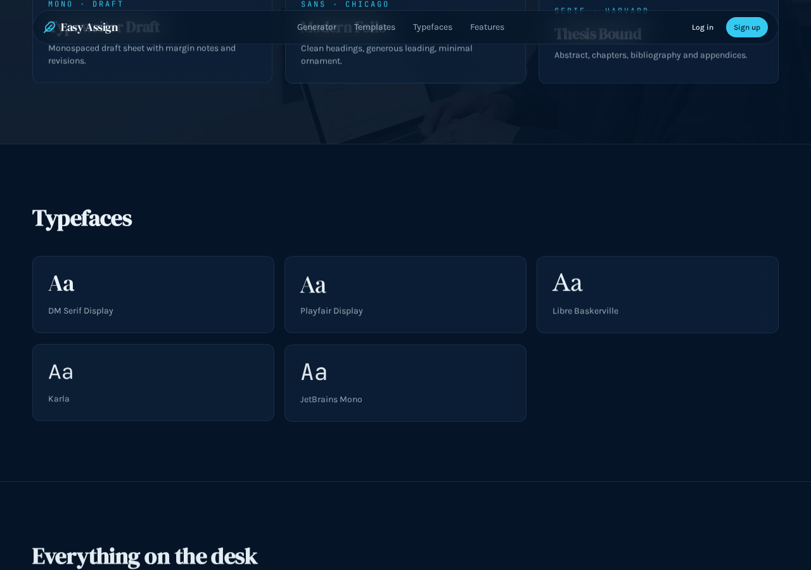
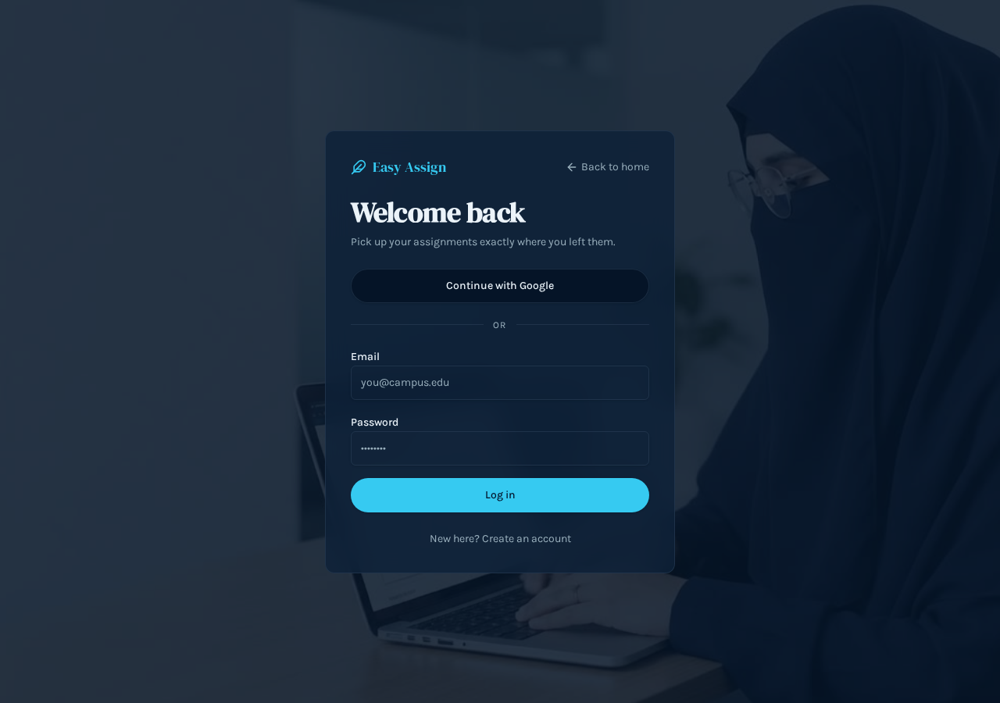

# 🎓 Easy Assign

**Easy Assign** is an AI-powered assignment generator for university students. Type a topic, pick a template, length, tone and language — and get a *complete* assignment: abstract, multi-paragraph sections with real argument and evidence, and a reference list. Then save it to your account or download it as a formatted PDF.

This is not a heading generator. It writes the full document the way a real assignment is written — paragraphs, not bullet points.

🔗 **Live demo:** https://retrogenius-studio-4x2pgyoig-rubabshaukat253-6494s-projects.vercel.app/

---

## ✨ Features

| | |
|---|---|
| 🤖 **Real AI writing** | Full academic prose — abstract, several titled sections with multi-paragraph arguments, scholars and theories cited in the text, and a reference list. A typical run writes 1,000–1,300 words. |
| 🗂️ **8 categories** | Essay, Research Paper, Lab Report, Case Study, Book Review, Presentation Outline, Coding Task, Reflection Journal. |
| 🌍 **8 languages** | English, Urdu, Spanish, French, German, Arabic, Turkish, Chinese. |
| 🎙️ **5 tones** | Academic, Formal, Conversational, Persuasive, Analytical. |
| 🎨 **6 templates** | Classic Manuscript (Serif · MLA), The Gazette (two-column editorial with drop caps), Lab Ledger (Grid · APA), Typewriter Draft (Mono), Modern Folio (Sans · Chicago), Thesis Bound (Serif · Harvard). Each one changes both the on-screen preview **and** the exported PDF. |
| 🔤 **5 typefaces** | DM Serif Display, Playfair Display, Libre Baskerville, Karla, JetBrains Mono — switchable live. |
| 📏 **Length control** | 1–20 pages (~300 words per page), with a live word estimate. |
| ✅ **Options** | Include references on/off, outline-only mode. |
| 👤 **Real accounts** | Sign up with email + password or Google, email confirmation, resend-confirmation, "back to home" navigation, friendly error messages. |
| 📚 **My library** | Every assignment you generate is stored to your account — open, re-read, or delete it any time. |
| 📄 **PDF download** | One click exports the same document with bold headings, the template's typography and correct sizing. Also: copy to clipboard. |
| 🎬 **Motion design** | Background videos, Ken Burns zooms, scroll reveals, animated transitions — and it stays smooth on mobile. |
| 📱 **Fully responsive** | Works properly on phone, tablet and desktop. |

---

## 🖼️ Screenshots

| Hero | Generator |
|:---:|:---:|
|  |  |

| Generated assignment | Sign in |
|:---:|:---:|
|  |  |

---

## 🛠️ Tech stack

| Layer | Technology |
|---|---|
| Framework | [TanStack Start](https://tanstack.com/start) v1 (React 19, file-based routing, SSR + server functions) |
| Build | Vite 8, Nitro |
| Styling | Tailwind CSS v4, custom design tokens (OKLCH), Radix UI / shadcn/ui components |
| AI | Lovable AI Gateway (`/v1/chat/completions`) with a large language model |
| Auth & data | Lovable Cloud — email/password + Google sign-in, row-level security so each user only sees their own work |
| PDF | jsPDF |
| Motion | CSS keyframe animations, IntersectionObserver, lazy-loaded `<video>` backgrounds |
| Hosting | Vercel (`vercel.json`) · Netlify (`netlify.toml`) · Lovable |

---

## 🚀 Getting started

**Prerequisites:** Node.js 20+ and npm.

```bash
# 1. Clone this repository (use the green "Code" button on GitHub)
cd easy-assign

# 2. Install dependencies
npm install
```

Create a `.env` file in the project root:

```env
VITE_SUPABASE_URL=your_backend_url
VITE_SUPABASE_PUBLISHABLE_KEY=your_publishable_key
VITE_SUPABASE_PROJECT_ID=your_project_id
LOVABLE_API_KEY=your_ai_gateway_key
```

The first three come from the backend of this project (Lovable Cloud → your project's settings), and `LOVABLE_API_KEY` is the key that lets the app call the AI model. The easiest way to get a working copy is to open this project in [Lovable](https://lovable.dev) — the backend, auth and AI key are wired automatically there, and the code syncs to GitHub.

```bash
# 3. Run locally
npm run dev          # http://localhost:8080

# 4. Production build
npm run build
```

> ⚠️ Never commit your `.env` file or share your keys publicly.

---

## 📖 How to use

1. Open the app and **Sign up** (check your inbox and confirm the email, then log in).
2. Type your topic — e.g. *"Impact of climate change on coastal cities of South Asia"*.
3. Choose category, language, tone, typeface and template; set the length with the slider.
4. Click **Write assignment** and wait for the full document to appear.
5. **Save to account** (it lands in My library), **Download PDF**, or **Copy**.

---

## 📁 Project structure

```
├── src/
│   ├── routes/            # pages: index, auth, library
│   ├── components/        # generator, site nav, background video, UI kit
│   ├── lib/               # assignment logic, AI prompt + server call, PDF export, templates
│   ├── hooks/             # auth session, scroll reveal
│   ├── integrations/      # backend client + auth middleware
│   ├── assets/            # media pointers used by the pages
│   └── styles.css         # Tailwind v4 theme, tokens, animations
├── supabase/migrations/   # database schema + security policies
├── public/screenshots/    # images used in this README
├── vercel.json            # Vercel config (includes a required media rewrite)
├── netlify.toml           # Netlify config
└── DEPLOYMENT.md          # full hosting guide
```

---

## 🌐 Deployment

- **Vercel** — import the GitHub repository; `vercel.json` is already set up. It contains a **required rewrite** for media assets (`/__l5e/assets-v1/*`) — do not remove it, or the background videos will 404. Add the environment variables listed above, and redeploy after every push.
- **Netlify** — build command `npm run build`, publish directory `dist/client` (already in `netlify.toml`).
- **Lovable** — one click, zero configuration: the backend, AI key and media all work out of the box.
- Details for all hosts: [DEPLOYMENT.md](./DEPLOYMENT.md)

---

## 📌 Good to know

- **Google sign-in** works on Lovable-hosted URLs. On a custom domain (Vercel/Netlify), use email + password, or register your own Google OAuth credentials in the backend's auth settings.
- **New accounts** receive a confirmation email — open it and click the link before logging in. There is a *Resend confirmation email* button if it doesn't arrive.
- The AI writing step needs `LOVABLE_API_KEY`; without it the app still runs, but assignment generation will fail.

---

## ⚠️ Disclaimer

This tool is for drafting, learning and brainstorming. Always read the output, add your own understanding and sources, and follow your institution's academic-integrity rules. Submitting generated work as your own is your responsibility.

---

## 🤝 Contributing

Fork it, create a branch (`git checkout -b feature/your-feature`), commit, push, and open a pull request.

---

## 📄 License

[MIT](LICENSE)

---

## 👩‍💻 Author

Made with ❤️ by **Rubab Shaukat** — for students who run out of nights, not ideas.

⭐ If this helped you, give the repository a star.
